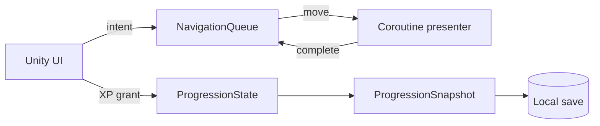

# Architecture

The demo separates state transitions from Unity presentation.

`ProgressionState` owns the XP curve, overflow and level cap. `NavigationQueue`
owns command order and the higher-priority finish rule. Neither class depends on
Unity, timing or scene objects, so their behavior is covered by EditMode tests.

The controller translates button and keyboard input into domain commands. It
animates only accepted moves and persists only snapshots returned by the domain
model. The interface is generated at runtime from Unity primitives; the public
repository carries no commercial art package or proprietary test material.

## Deliberate boundaries

- PlayerPrefs is sufficient for this local demo. A production service would put
  versioning, migration and cloud conflict resolution behind a storage adapter.
- The queue demonstrates deterministic semantics on a single client. It does
  not claim network authority or rollback support.
- The XP curve is injected and validated. Economy balancing and live tuning are
  product inputs, not hidden inside the view.

