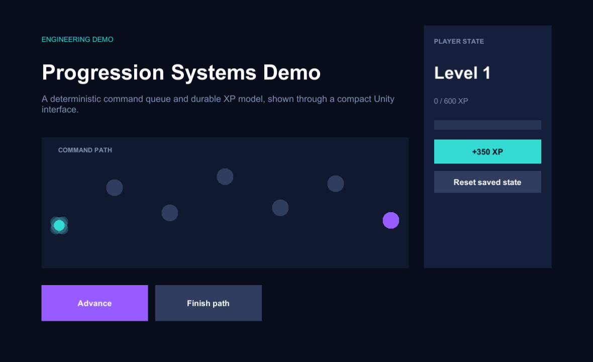

# Progression systems demo

A Unity demo with XP progression, local persistence and queued path navigation.



## Design

- `ProgressionState` handles grants across multiple levels, XP overflow, invalid
  input and a configurable level cap.
- `NavigationQueue` processes advance requests in order. A finish request replaces
  pending commands.
- The Unity presenter handles animation and input. The domain classes run
  independently of scene timing.
- Local persistence stores a versionable snapshot of progression state.

The runtime bootstrap creates the interface from Unity primitives. The scene
contains no serialized gameplay state.

See [the architecture note](Docs/ARCHITECTURE.md) for boundaries and production
tradeoffs.

## Run

1. Install Unity **2022.3.61f1** with macOS build support.
2. Open the repository folder and let Unity restore the declared packages.
3. Choose **Demo > Create clean scene**, then enter Play Mode.
4. Use **Advance**, **Finish path** and **+350 XP**. Keyboard shortcuts are
   Space, F and X.

## Test and build

Run EditMode tests from **Window > General > Test Runner**, or on macOS:

```sh
UNITY="/Applications/Unity/Hub/Editor/2022.3.61f1/Unity.app/Contents/MacOS/Unity"
"$UNITY" -batchmode -projectPath "$PWD" -runTests -testPlatform editmode \
  -testResults "$PWD/Builds/editmode-results.xml" -quit

"$UNITY" -batchmode -projectPath "$PWD" -buildTarget StandaloneOSX \
  -executeMethod OguzhanOzdemir.ProgressionDemo.Editor.DemoProjectBuilder.BuildMac \
  -buildOutput "$PWD/Builds/macOS/ProgressionSystemsDemo.app" -quit
```

## License and provenance

MIT licensed. This independent demo by Oguzhan Ozdemir develops progression and
queued-navigation ideas from an earlier personal Unity exercise. It uses
generated UI primitives without third-party art or runtime packages.
